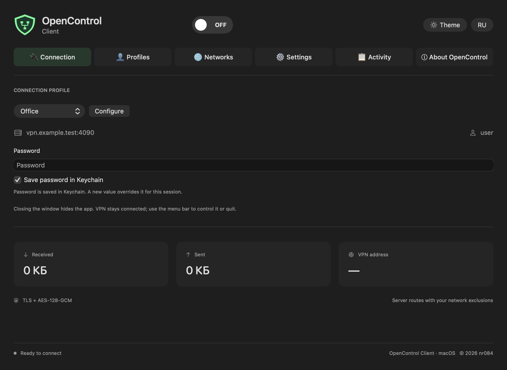

> Experimental laboratory prerelease: [v0.1.0-lab.1](https://github.com/nr084/opencontrol-client-macos-releases/releases/tag/v0.1.0-lab.1). VPN activation is enabled but unverified; SIP-disabled testing only. [RU/EN instructions](LAB_TESTING.md). No production release yet.

<h1 align="center">OpenControl Client for macOS</h1>

A native client for your private network. Universal 2 · Apple Silicon + Intel · English / Русский

[Русский](README.md) | **English**

A macOS client in development, based on SwiftUI and OpenControl Library, for private
Kerio Control networks. It carries over the Android icon and profile logic and
provides a menu bar control and a planned PKG installer.

> **No release is available yet.** The app and System Extension build for both
> CPU architectures. VPN activation requires Apple Developer signing and
> provisioning. The owner chose not to distribute a test build with only a working
> UI. Live corporate-server interoperability is not yet verified.

## Planned distribution

[Releases](https://github.com/nr084/opencontrol-client-macos-releases/releases)

One PKG for **macOS 13+**, installing **OpenControl Client.app** for Apple Silicon
and Intel, with an uninstaller, SHA256 and installation guide. No installation
files are currently published.

*Rendered from the actual SwiftUI interface using a demonstration profile.
`vpn.example.test` is illustrative, not a project-provided server.*

## Implemented in source

Profiles, Keychain password storage, certificate inspection and explicit trust,
per-certificate expiry consent, Android-compatible QR/JSON import and QR display,
IPv4 CIDR exclusions, reconnection, traffic/rate/session statistics, VPN address,
menu bar control and complete Russian/English UI.

Android per-application selection is not supported; routes apply to all apps.
IPv6 is captured and blocked during a VPN session. This is not an always-on kill switch.

[Validation and limitations](VALIDATION.md) · [Changelog](CHANGELOG.md) ·
[Future installation / removal](docs/INSTALL.en.md) · [Privacy](PRIVACY.md) ·
[Issues](https://github.com/nr084/opencontrol-client-macos-releases/issues)

A short synthetic loopback test covers TLS/UDP, key rotation and route-update
continuity. Signed System Extension activation, OS route installation, a real
corporate server and physical Intel acceptance still need testing.

Access comes from your administrator. No public servers or accounts are supplied.
Do not post credentials, keys or corporate network logs in issues.

**Independent project, not affiliated with or supported by Kerio/GFI.** Names are
used only to describe intended compatibility. This repository contains user docs
and will host releases; application sources are private. The
[protocol library](https://github.com/nr084/opencontrol-protocol) is a separate public project.

© nr084
