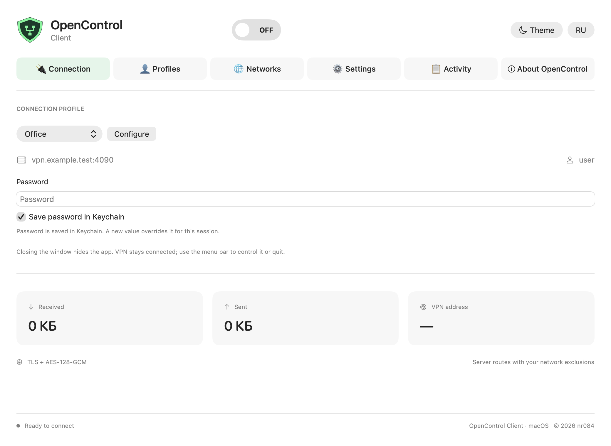
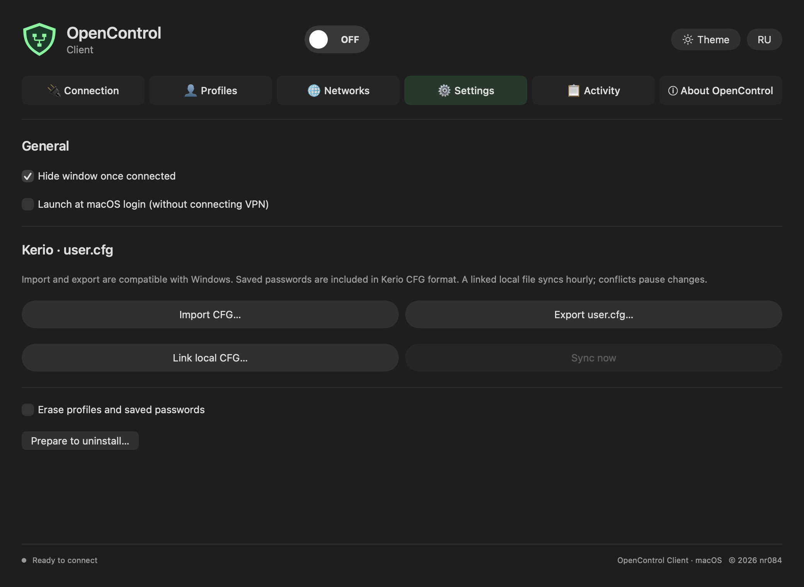

<h1 align="center">OpenControl Client · macOS</h1>

Universal 2 · Apple Silicon + Intel · macOS 13+ · English / Русский

[Русский](README.md) · **English**

Windows client features adapted for Mac: six tabs, VPN switch, transparent shield,
dark/light themes and native macOS controls.

**[Download 0.2.0-lab.1](https://github.com/nr084/opencontrol-client-macos-releases/releases/tag/v0.2.0-lab.1)**
— experimental laboratory build requiring SIP-disabled testing.
**Extension activation and live VPN traffic are not yet verified.**
One OpenControl Client.app supports both architectures. The release includes PKG,
uninstaller, SHA256 and [RU/EN lab instructions](LAB_TESTING.md).

## Features

- Sorted profiles, default selection and Keychain passwords.
- Certificate inspection, SHA-256 trust and exact-certificate expiry consent.
- Kerio CFG import with duplicate policy, user.cfg export and opt-in hourly/manual
  local sync including deletions; conflicting edits pause synchronization.
- Compatible QR display, PNG export and image/JSON import.
- Shared IPv4 exclusions, routes and DNS through Network Extension.
- Menu bar connect, reconnect and profile switch after previous-session cleanup.
- Close hides the window; explicit quit waits for VPN shutdown.
- Last 500 session events, session traffic totals and notifications.
- Opt-in login startup without automatically connecting VPN.
- Daily stable update checks, Universal PKG download and SHA256 verification.
  Installation is handed to standard macOS Installer while VPN is stopped.

Actual SwiftUI renders with synthetic data only. `vpn.example.test` is illustrative,
not a project-provided server.

[Validation](VALIDATION.md) · [Changelog](CHANGELOG.md) · [Privacy](PRIVACY.md) ·
[Issues](https://github.com/nr084/opencontrol-client-macos-releases/issues).

Build, signatures, architectures, synthetic protocol and CFG checks pass. Installed
system behavior, real corporate firewall interoperability and physical Intel hardware
still require testing. This is not a production-ready VPN release.
CFG/QR exports contain credentials; never publish them or corporate network logs.

Access comes from your administrator. No public servers or accounts are provided.
Independent project, not affiliated with Kerio/GFI. App sources are private;
[protocol library](https://github.com/nr084/opencontrol-protocol) remains a separate
public project. © 2026 nr084.
