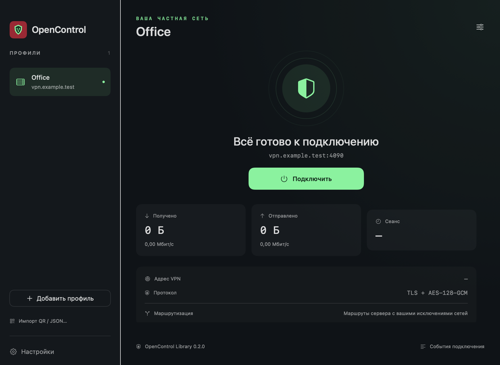

> Experimental laboratory prerelease: [v0.1.0-lab.1](https://github.com/nr084/opencontrol-client-macos-releases/releases/tag/v0.1.0-lab.1). VPN activation is enabled but unverified; SIP-disabled testing only. [RU/EN instructions](LAB_TESTING.md). No production release yet.

<h1 align="center">OpenControl Client для macOS</h1>

Нативный клиент для вашей частной сети. Universal 2 · Apple Silicon + Intel · Русский / English

**Русский** | [English](README.en.md)

Разрабатываемый macOS-клиент на SwiftUI и OpenControl Library для частных сетей
Kerio Control. Профили и значок перенесены из Android-клиента; предусмотрены
управление из строки меню и установка через PKG.

> **Доступен лабораторный prerelease 0.1.0-lab.1.** Проверены сборка и упаковка. Активация расширения и корпоративное подключение ещё не проверены. Для обычного релиза с включённым SIP нужны подпись и профили Apple.

## Будущий выпуск

[Страница выпусков](https://github.com/nr084/opencontrol-client-macos-releases/releases)

Планируется один PKG для **macOS 13+**, устанавливающий **OpenControl Client.app**
с поддержкой Apple Silicon и Intel. С выпуском будут предоставлены сценарий
удаления, SHA256 и инструкция. Лабораторный PKG, удаление и SHA256 доступны в prerelease.

*Отрисовка настоящего SwiftUI-интерфейса с демонстрационным профилем.
`vpn.example.test` — иллюстративный адрес, не сервер проекта.*

## Реализовано в исходниках

- Несколько профилей, хранение паролей в Связке ключей macOS.
- Просмотр сертификата, подтверждение SHA-256 либо доверенный CA в PEM.
- Отдельное подтверждение для конкретного просроченного сертификата.
- Импорт QR из изображения или JSON; показ QR для переноса в Android.
- Исключения IPv4-сетей в CIDR, до 128 записей.
- Автопереподключение, ROUTES, TLS и AES-128-GCM в Rust-ядре.
- Статистика, скорости, время сеанса, адрес VPN и управление из строки меню.
- Полные русский и английский интерфейсы, системный язык или ручной выбор.

Android-выбор отдельных приложений не переносится на macOS: здесь маршруты
действуют для всех приложений. IPv6 не туннелируется и блокируется во время
VPN-сеанса. Приложение не является always-on kill switch.

## Статус и документация

[Проверки и ограничения](VALIDATION.md) · [История разработки](CHANGELOG.md) ·
[Установка и удаление будущего выпуска](docs/INSTALL.ru.md) ·
[Конфиденциальность](PRIVACY.md)

Синтетический 32-секундный тест подтвердил работу ядра: TLS/UDP, смену ключей и
обмен при обновлении маршрутов. Он не заменяет испытания подписанного System
Extension, маршрутов macOS, корпоративного сервера и физического Intel Mac.

## Обратная связь

[Сообщить о проблеме](https://github.com/nr084/opencontrol-client-macos-releases/issues).
Не прикладывайте credentials, ключи и корпоративные сетевые журналы.
Доступ предоставляет администратор вашей сети; проект не выдаёт VPN-аккаунты
и не предоставляет открытых серверов.

**Независимый проект: не продукт Kerio/GFI, не связан с ними и не поддерживается ими.**
Товарные знаки упоминаются только для указания назначения и совместимости.

Здесь размещаются пользовательские документы и будущие выпуски. Исходники
приложения приватные. [OpenControl Protocol](https://github.com/nr084/opencontrol-protocol)
остаётся отдельным публичным проектом.

© nr084
