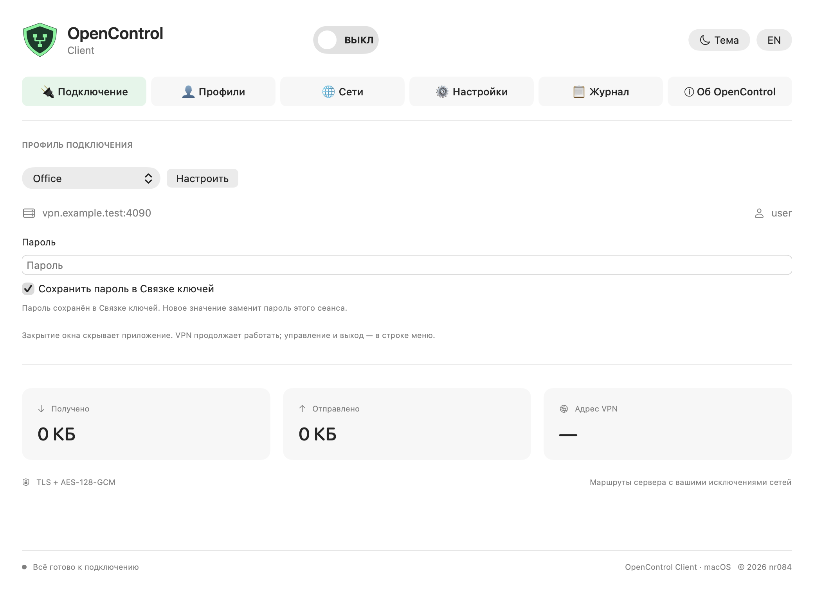
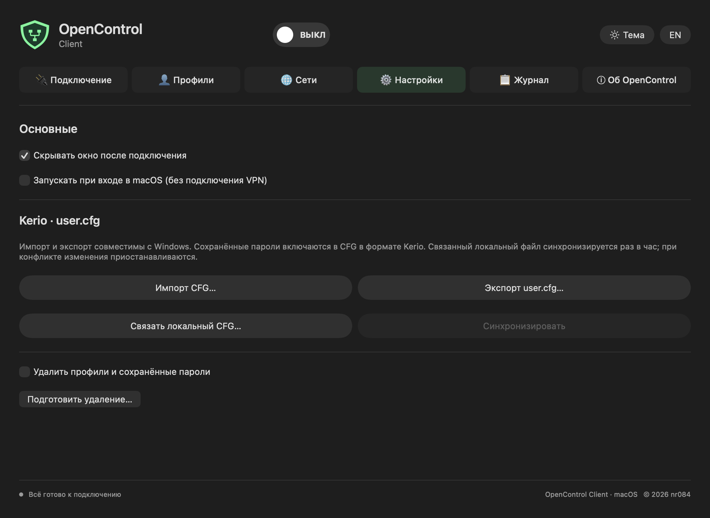

<h1 align="center">OpenControl Client · macOS</h1>

Universal 2 · Apple Silicon + Intel · macOS 13+ · Русский / English

**Русский** · [English](README.en.md)

Интерфейс и возможности Windows-клиента адаптированы для Mac: шесть вкладок,
переключатель VPN, прозрачный значок и две темы с нативными элементами macOS.

**[Скачать 0.2.0-lab.1](https://github.com/nr084/opencontrol-client-macos-releases/releases/tag/v0.2.0-lab.1)**
— экспериментальная сборка для лабораторного теста с отключённым SIP.
**Активация расширения и реальное VPN-подключение пока не проверены.**
Установщик содержит один OpenControl Client.app для обеих архитектур.
В выпуске: PKG, удаление, SHA256 и [инструкция RU/EN](LAB_TESTING.md).

## Возможности

- Профили с сортировкой, выбором по умолчанию и паролями в Keychain.
- Проверка сертификата, SHA-256 и согласие на конкретный просроченный сертификат.
- Kerio CFG: импорт с выбором обработки дублей, экспорт user.cfg.
- Добровольная синхронизация локального CFG раз в час и вручную, включая удаления;
  при конфликте изменения приостанавливаются.
- Совместимый QR профиля: показать, сохранить PNG, импортировать изображение/JSON.
- Общие исключения IPv4 CIDR, маршруты и DNS через Network Extension.
- Меню в строке macOS: подключение, переподключение и смена профиля после остановки старой сессии.
- Закрытие окна скрывает приложение; выход дожидается остановки VPN.
- История последних 500 событий текущего запуска, счётчики за сеанс и уведомления.
- Добровольный автозапуск при входе без подключения VPN.
- Ежедневная проверка стабильных обновлений и загрузка Universal PKG с проверкой SHA256.
  Установка после отключения VPN через стандартный Installer с системным подтверждением.

Отрисовки настоящего SwiftUI-интерфейса используют только демонстрационный профиль.
`vpn.example.test` — иллюстративный адрес, не сервер проекта.

## Проверки и ограничения

[Результаты проверок](VALIDATION.md) · [История выпусков](CHANGELOG.md) ·
[Конфиденциальность](PRIVACY.md) · [Сообщить о проблеме](https://github.com/nr084/opencontrol-client-macos-releases/issues).

Сборка, подписи, обе архитектуры, синтетические тесты ядра и CFG проверены.
Установленные системные функции, корпоративный firewall и физический Intel Mac
требуют отдельных испытаний. Это не готовый производственный VPN-релиз.
Пароли включаются в экспорт CFG/QR; не публикуйте эти файлы и корпоративные журналы.

Доступ предоставляет администратор вашей сети. Проект не выдаёт аккаунты и не
предоставляет публичные VPN-серверы. Независимый проект, не связан с Kerio/GFI.
Исходники приложения приватные; [protocol library](https://github.com/nr084/opencontrol-protocol)
остаётся отдельным публичным проектом. © 2026 nr084.
